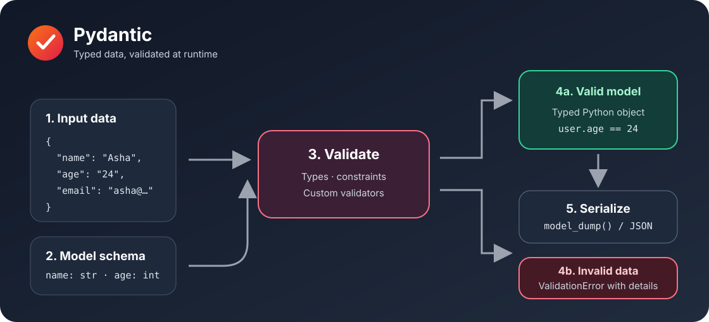

# Working with Pydantic

Small, runnable examples for learning [Pydantic](https://docs.pydantic.dev/latest/) and its data validation features. The examples use patient records to demonstrate typed models, field constraints, custom validators, nested models, computed fields, and serialization.



## How Pydantic works

1. Define a model by inheriting from `BaseModel` and declaring fields with Python type annotations.
2. Provide input data, such as a dictionary.
3. Pydantic validates the input against the model, converts compatible values where appropriate, and runs any custom validators.
4. If validation succeeds, you get a typed model instance. If it fails, Pydantic raises a `ValidationError` describing the invalid fields.
5. Convert the model to Python data or JSON with methods such as `model_dump()` and `model_dump_json()`.

For example:

```python
from pydantic import BaseModel, EmailStr


class User(BaseModel):
    name: str
    age: int
    email: EmailStr


user = User(name="Asha", age="24", email="asha@example.com")
print(user.age)  # 24 (validated and converted to int)
print(user.model_dump())
```

## Examples in this repository

| File | What it demonstrates |
| --- | --- |
| [`Base_Model.py`](Base_Model.py) | `BaseModel`, typed fields, `Field` constraints and metadata, and optional fields |
| [`Feild_Validator.py`](Feild_Validator.py) | Field-level validation with `@field_validator` |
| [`Model_Validator.py`](Model_Validator.py) | Cross-field validation with `@model_validator` |
| [`Nested_Model.py`](Nested_Model.py) | Using one Pydantic model as a field in another model |
| [`computed_feild.py`](computed_feild.py) | Adding a derived value with `@computed_field` |
| [`serialization.py`](serialization.py) | Exporting model data with `model_dump()` and `model_dump_json()` |

Each file is a standalone learning example and can be run directly. Names and spelling in filenames reflect the existing project.

## Setup

The examples use Pydantic v2. Create and activate a virtual environment, then install Pydantic and its email-validation extra:

```bash
python -m venv .venv
```

Activate it:

```bash
source .venv/bin/activate
```

In Windows PowerShell, use:

```powershell
.\.venv\Scripts\Activate.ps1
```

Then install Pydantic and its email-validation extra:

```bash
python -m pip install "pydantic[email]"
```

Run an example from the project directory:

```bash
python Base_Model.py
```

Replace `Base_Model.py` with another filename from the table to try a different feature.

## Useful links

- [Pydantic documentation](https://docs.pydantic.dev/latest/)
- [Pydantic models](https://docs.pydantic.dev/latest/concepts/models/)
- [Pydantic validators](https://docs.pydantic.dev/latest/concepts/validators/)
- [Pydantic serialization](https://docs.pydantic.dev/latest/concepts/serialization/)
